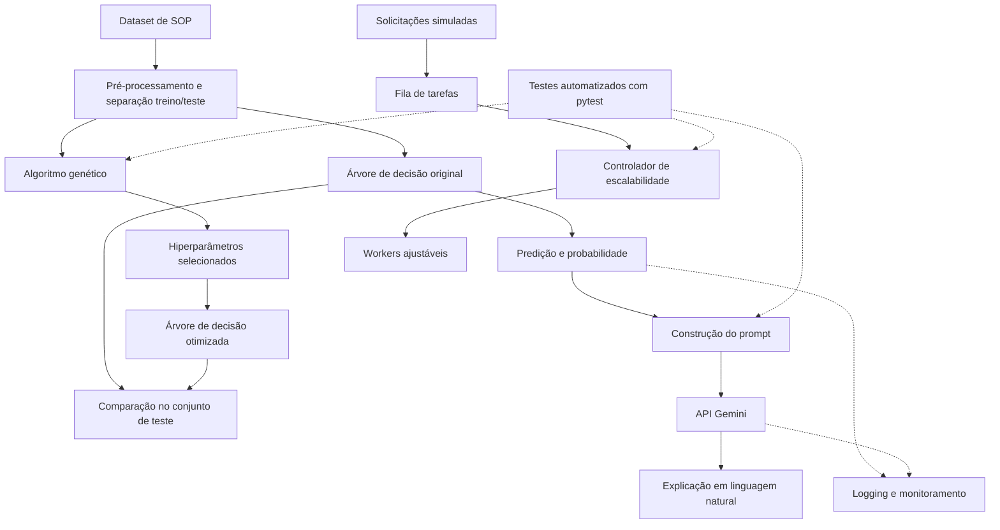

# Tech Challenge — Fase 2
## Relatório técnico e documentação da solução

**Projeto 1 — Otimização de Modelos de Diagnóstico**  
**Pós-graduação em Inteligência Artificial para Desenvolvedores — FIAP**

> Este README reúne a documentação de execução e o relatório técnico da Fase 2. Os experimentos, gráficos e demonstrações executáveis estão no notebook `main.ipynb`. O sistema é um protótipo acadêmico de apoio à interpretação de resultados, **não** uma ferramenta de diagnóstico clínico.

## 1. Objetivo e contexto

O projeto dá continuidade ao projeto da Fase 1, na qual foram preparados dados relacionados à Síndrome dos Ovários Policísticos (SOP) e treinados classificadores para identificar padrões associados à condição. Nesta segunda fase, foram abordados três requisitos: otimização de hiperparâmetros por algoritmo genético, escalabilidade e monitoramento e interpretação de resultados com uma LLM pré-treinada.

A solução foi implementada em Python e organizada em módulos, com experimentos e demonstrações em Jupyter Notebook.

## 2. Dados e modelos de referência

Foi utilizado o conjunto `PCOS_data_without_infertility.xlsx`. Após o pré-processamento descrito no notebook, foram consideradas 539 amostras, separadas em conjuntos de treinamento (80%) e teste (20%), de maneira estratificada e com `random_state=42`.

As oito características utilizadas foram:

- `Follicle No. (R)` e `Follicle No. (L)`;
- `Skin darkening (Y/N)`;
- `hair growth(Y/N)`;
- `Weight gain(Y/N)`;
- `Cycle(R/I)`;
- `Pimples(Y/N)`;
- `BMI`.

A variável-alvo foi `PCOS (Y/N)`. Na Fase 1, foram treinados modelos de Regressão Logística e Árvore de Decisão. Para a otimização genética da Fase 2, foi escolhida a árvore com `max_depth=5` e `random_state=42`, devido à possibilidade de representar seus hiperparâmetros como genes.

## 3. Arquitetura da solução



A arquitetura separa as responsabilidades principais:

| Componente | Responsabilidade |
|---|---|
| `main.ipynb` | Preparação dos dados, experimentos, gráficos e demonstrações |
| `src/algo_genetico.py` | Busca de hiperparâmetros da árvore de decisão |
| `src/llm_gemini.py` | Construção de prompts e integração com o Gemini |
| `src/monitoramento.py` | Registro de operações, duração e falhas |
| `src/escalabilidade.py` | Fila, workers e ajuste automático da concorrência |
| `tests/` | Validação automatizada dos componentes |

**Decisões de implementação:** o algoritmo genético utiliza apenas os dados de treinamento para selecionar hiperparâmetros; o conjunto de teste é reservado à avaliação final. A escalabilidade é demonstrada localmente, com tarefas simuladas, sem infraestrutura em nuvem. O uso de nuvem é opcional no enunciado.

## 4. Otimização por algoritmo genético

### 4.1 Representação genética e operadores

Cada indivíduo representa quatro hiperparâmetros da árvore de decisão:

| Gene | Intervalo / valores |
|---|---|
| `max_depth` | 2 a 15 |
| `min_samples_split` | 2 a 20 |
| `min_samples_leaf` | 1 a 10 |
| `criterion` | `gini` ou `entropy` |

O algoritmo foi implementado com população inicial aleatória, seleção por torneio, cruzamento de um ponto, mutação e elitismo. O fitness é a média do F1-score em validação cruzada estratificada de três partições, calculada exclusivamente com os dados de treinamento.

### 4.2 Experimentos

Foram executadas três configurações, variando simultaneamente população, gerações e taxa de mutação:

| Experimento | População | Gerações | Taxa de mutação | Melhor fitness (F1) | Tempo de execução |
|---|---:|---:|---:|---:|---:|
| 1 | 10 | 100 | 10% | 0,7868 | 18,08 s |
| 2 | 50 | 200 | 25% | 0,7918 | 180,43 s |
| 3 | 100 | 300 | 50% | 0,7918 | 587,40 s |

Os três experimentos atingiram o mesmo fitness na precisão apresentada. A configuração do primeiro experimento obteve esse resultado com menor custo computacional. Como os parâmetros foram alterados simultaneamente, os resultados comparam configurações completas, não o efeito isolado de cada parâmetro.

O indivíduo selecionado foi `max_depth=8`, `min_samples_split=14`, `min_samples_leaf=6` e `criterion=gini`.

### 4.3 Comparação no conjunto de teste

| Métrica | Árvore original | Árvore otimizada | Diferença |
|---|---:|---:|---:|
| Acurácia | 0,8611 | 0,8241 | -0,0370 |
| Precisão | 0,7632 | 0,6905 | -0,0727 |
| Recall | 0,8286 | 0,8286 | 0,0000 |
| F1-score | 0,7945 | 0,7532 | -0,0413 |

**Resultado:** a otimização genética não melhorou a generalização nesta execução. Embora o algoritmo tenha encontrado uma configuração com fitness competitivo durante a validação cruzada, o desempenho no conjunto de teste foi inferior ao da árvore original. O recall permaneceu estável, enquanto a precisão e o F1-score diminuíram.

Essa diferença pode decorrer de variações amostrais e de diferenças entre o desempenho médio na validação cruzada e no conjunto de teste. O conjunto de teste não foi utilizado para reajustar a configuração após a comparação, preservando a independência da avaliação.

## 5. Integração com LLM para interpretação

Foi integrada uma LLM da família Gemini, por meio do SDK `google-genai`, para transformar os resultados numéricos da classificação em explicações em linguagem natural. O módulo recebe as características da amostra, a classe prevista e a probabilidade estimada pelo classificador.

### 5.1 Engenharia de prompt

O prompt solicita uma resposta organizada em quatro partes: significado do resultado, interpretação contextual das características fornecidas, limitações da previsão e informações clínicas adicionais que poderiam ser relevantes.

As instruções também procuram evitar afirmações diagnósticas definitivas, sintomas inventados, recomendações terapêuticas e atribuições de importância causal a características sem uma análise de explicabilidade apropriada.

A probabilidade exibida é uma estimativa do classificador, não uma probabilidade clínica validada de SOP. A interpretação gerada pela LLM não substitui avaliação médica.

### 5.2 Avaliação qualitativa

Foram realizadas duas demonstrações: uma amostra prevista como negativa, com probabilidade estimada de classe positiva de 0,00%, e outra prevista como positiva, com probabilidade estimada de 87,50%.

Nas respostas examinadas, o Gemini apresentou explicações coerentes com os dados fornecidos e incluiu ressalvas sobre a natureza não conclusiva das previsões. A avaliação foi qualitativa, restrita às respostas observadas, e não constitui validação clínica da ferramenta.

Limitações: a LLM pode interpretar incorretamente códigos de variáveis, sugerir relações que não foram demonstradas pelo classificador ou produzir respostas imprecisas. As explicações precisam ser lidas como apoio à interpretação, não como justificativas causais verificadas do modelo.

## 6. Monitoramento e logging

O módulo `src/monitoramento.py` utiliza `logging` e `time` para registrar eventos em `logs/aplicacao.log`, incluindo data e horário, operação, duração, sucesso ou falha, modelo e, quando aplicável, tipo/código de erro. Não são registrados dados clínicos individuais nem credenciais de acesso.

Exemplos observados durante os testes:

| Operação | Resultado | Duração |
|---|---|---:|
| Gemini | Erro HTTP 503 | 11,0850 s |
| Gemini | Sucesso | 353,0208 s |
| Gemini | Sucesso | 512,8820 s |
| Inferência da árvore, 108 amostras | Sucesso | 0,0014 s |

A latência média das duas chamadas bem-sucedidas ao Gemini foi de aproximadamente 432,95 s. Esse tempo inclui tudo o que ocorreu durante a chamada medida e pode envolver espera, comunicação e eventuais tentativas internas do cliente. A inferência local foi significativamente mais rápida no cenário observado.

Os resultados ilustram a importância de acompanhar latência e falhas em dependências externas, sem constituir um benchmark amplo da API.

## 7. Escalabilidade automática

Foi implementado um controlador local baseado em `queue` e `threading`. Ele acompanha o número de tarefas pendentes e em execução e ajusta a quantidade de workers entre limites configurados.

Na demonstração, foram utilizados mínimo de 1 worker, máximo de 5 workers e 30 solicitações simuladas, cada uma com espera de 0,5 segundo. O processamento terminou em aproximadamente 3,90 s, com crescimento até 5 workers e retorno ao mínimo após o esvaziamento da fila.

A execução sequencial teórica das tarefas exigiria cerca de 15 segundos; a comparação é apenas ilustrativa, pois inclui diferenças de controle e espera. O gráfico de demanda e workers está disponível no notebook.

Escopo: o mecanismo demonstra ajuste automático da concorrência **dentro de um processo local**, não escalabilidade horizontal em nuvem. As tarefas utilizadas na demonstração são simuladas; os resultados não representam throughput real da API Gemini. Para tarefas intensivas em CPU, threads podem não produzir o mesmo ganho.

## 8. Testes automatizados

Os testes foram desenvolvidos com `pytest` e abrangem:

| Teste | Verificação | Resultado |
|---|---|---|
| Algoritmo genético | Retorno de indivíduo válido, fitness e histórico | Aprovado |
| Escalabilidade | Execução das tarefas e ajuste da quantidade de workers | Aprovado |
| Integração com LLM | Chamada e resposta usando mock, sem acesso à API real | Aprovado |

**Resultado observado: 3 testes executados, 3 aprovados.** Os testes cobrem os cenários implementados, mas não equivalem a uma verificação exaustiva de todos os comportamentos possíveis.

Para executar:

```bash
python -m pytest -v
```

## 9. Instalação e execução

### 9.1 Ambiente

Utilize um ambiente virtual Python e instale as dependências do projeto. Na raiz do repositório:

```bash
python -m venv .venv
source .venv/bin/activate
python -m pip install -r requirements.txt
```

> **Antes da entrega:** confirme que `requirements.txt` existe e contém as dependências efetivamente utilizadas no notebook e nos módulos, incluindo `pytest`, `google-genai`, `python-dotenv`, `numpy`, `pandas`, `scikit-learn`, `matplotlib`, `openpyxl` e `jupyter`, conforme aplicável. Não é necessário instalar serviços de nuvem.

### 9.2 Chave de API

Para as demonstrações reais do Gemini, crie um arquivo `.env` na raiz do projeto:

```dotenv
GEMINI_API_KEY=sua_chave_aqui
```

Não publique `.env`, chaves, credenciais, arquivos de log nem diretórios de ambiente virtual. O `.gitignore` deve contemplá-los.

### 9.3 Demonstração

Abra `main.ipynb` no Jupyter e execute as seções na ordem indicada. Os experimentos genéticos maiores podem levar vários minutos; as chamadas ao Gemini dependem da disponibilidade do serviço externo.

Os testes automatizados podem ser executados separadamente, sem chave de API real, pois a integração com Gemini é simulada por mock.

## 10. Desafios enfrentados e decisões adotadas

- **Ausência de melhoria após otimização:** o melhor fitness na validação cruzada não se traduziu em ganho no conjunto de teste. O resultado foi mantido e analisado, sem selecionar uma nova configuração com base no teste.
- **Custo computacional:** populações e gerações maiores elevaram substancialmente o tempo de execução, sem melhoria observada do fitness.
- **Instabilidade e latência da API externa:** foram observados erro HTTP 503 e chamadas demoradas. O monitoramento registra essas ocorrências; os testes de integração usam mock para não depender da API.
- **Interpretação clínica:** o prompt inclui limitações explícitas para reduzir o risco de apresentar uma previsão estatística como diagnóstico médico.
- **Demonstração de escalabilidade:** foi adotada uma fila local com carga simulada para demonstrar adaptação automática sem depender de infraestrutura em nuvem.

## 11. Conclusão

A Fase 2 integrou otimização genética, interpretação em linguagem natural, monitoramento, escalabilidade local e testes automatizados a uma solução de classificação de dados relacionados à SOP.

O algoritmo genético foi implementado e avaliado em três experimentos, mas **não superou o modelo original** no conjunto de teste. A integração com Gemini demonstrou a possibilidade de produzir explicações textuais com ressalvas clínicas, embora permaneça sujeita a limitações de qualidade, latência e disponibilidade. A simulação de escalabilidade evidenciou ajuste automático do número de workers, e os testes automatizados validaram os principais fluxos implementados.

Os resultados são acadêmicos e não autorizam uso clínico sem validação adicional.

## 12. Vídeo de demonstração


Link para o vídeo de apresentação: https://youtu.be/hMKF3I0U-V8